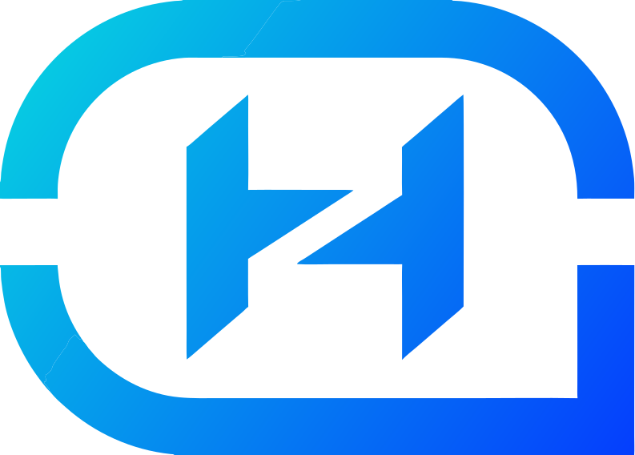

# HQHarness



[English](README.md) · [简体中文](README.zh.md) · [日本語](README.ja.md) · [Русский](README.ru.md) · [Español](README.es.md) · [Português](README.pt.md)

[DeepSeek Harness](https://github.com/deepseek-ai/deepseek-harness) を利用するローカル優先のデスクトップ環境です。[DataElement DSH Desktop](https://github.com/dataelement/dsh-desktop) の独立したブランドフォークで、基準コミットは `115a0b474cc2c4794316171c640a8898398591fe` です。

同梱 runtime は `@deepseek-ai/dsh@0.2.0-rc.2` に固定しています。

## 現在の状態

HQHarness のソースとネイティブビルド手順を提供します。HQHarness の配布サイト、リリースリポジトリ、署名 ID、更新サービスは未設定です。ビルド成功や CI 成果物は、正式公開、署名、全プラットフォーム検証を意味しません。配布前に自分の証明書とサービスを設定してください。[リリースガイド](docs/hqharness-release.md) を参照してください。

## 機能

- Electron による既存 Harness runtime と Web UI の自動起動
- ワークスペース選択、モデル設定、Profile とセッション
- `.dshpreset` の入出力と PPTX、DOCX、XLSX ツール
- Safe Mode、プラグイン復旧、起動診断（通常画面が開かない場合は `--safe-mode` で起動）
- LAN または任意の Cloudflare Quick Tunnel によるスマートフォン連携。Pinggy に切り替える予備経路も提供
- ネイティブメニュー、テーマ、自分のサービス設定後の更新機能

互換性のためモデル提供元と上流パッケージ名を保持します。HQHarness は DeepSeek または DataElement の公式製品ではありません。

## 開発

Node.js 24 以降と npm を使用し、このチェックアウトで実行します。

```sh
npm ci
npm run dev
npm run typecheck
npm run build
npm test
git diff --check
```

postinstall はパッチとブランド生成を含め最後まで成功する必要があります。開発版は `HQHarness Dev` / `hqharness-dev`、製品版は `HQHarness` / `hqharness` を使います。DSH Desktop のデータは自動移行しません。同じ開発 Profile を同時に変更しないでください。

## パッケージ

対象と同じ OS・CPU で未署名開発版を作成します。

```sh
npm run package:dev:mac:arm64
npm run package:dev:mac:x64
npm run package:dev:win
```

対象は macOS DMG/ZIP と Windows x64 NSIS です。Linux と Windows ARM64 の配布は未設定です。署名製品版には自分の証明書とインストール後の検証が必要です。

[開発ガイド](docs/development.md)、[ブランド規約](docs/brand-guidelines.md)、[アーキテクチャ](docs/architecture.md)、[PPT runtime](packages/ppt-runtime/README.md) も参照してください。上流プロトコルの識別子と履歴文書は保持します。[MIT ライセンス](LICENSE) と DataElement の元の著作権表示を保持し、依存関係にはそれぞれのライセンスが適用されます。
