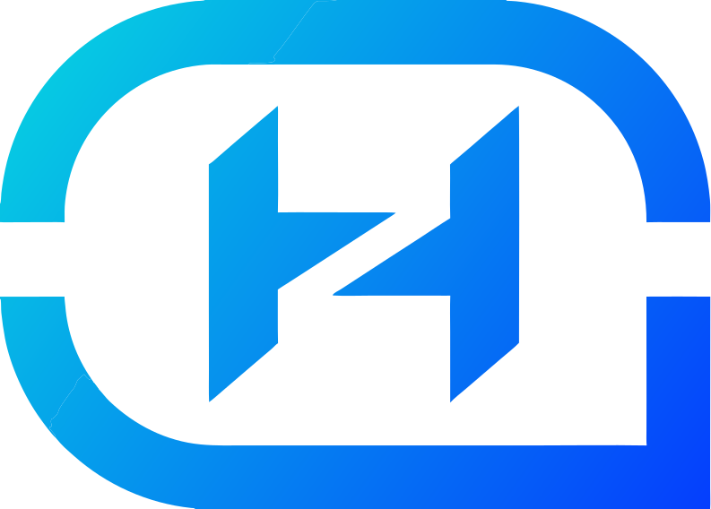

# HQHarness



[English](README.md) · [简体中文](README.zh.md) · [日本語](README.ja.md) · [Русский](README.ru.md) · [Español](README.es.md) · [Português](README.pt.md)

Локальное настольное рабочее пространство на базе [DeepSeek Harness](https://github.com/deepseek-ai/deepseek-harness). Независимый брендированный форк [DataElement DSH Desktop](https://github.com/dataelement/dsh-desktop), исходный коммит: `115a0b474cc2c4794316171c640a8898398591fe`.

Встроенный runtime закреплён на версии `@deepseek-ai/dsh@0.2.0-rc.2`.

## Статус

Репозиторий содержит исходники HQHarness и нативные сборочные процессы. Сайт загрузки, репозиторий выпусков, сертификаты подписи и сервис обновлений HQHarness пока не настроены. Успешная сборка или артефакт CI не подтверждает публикацию, подпись или проверку всех платформ. Перед распространением настройте собственные сертификаты и сервисы по [руководству выпуска](docs/hqharness-release.md).

## Возможности

- Electron запускает существующие Harness runtime и Web UI
- Выбор рабочих каталогов, настройки моделей, профили и сеансы
- Импорт/экспорт `.dshpreset`, инструменты PPTX, DOCX и XLSX
- Safe Mode, восстановление плагинов и диагностика запуска; если обычный интерфейс недоступен, используйте `--safe-mode`
- Подключение телефона по LAN или через Cloudflare Quick Tunnel с резервным вариантом Pinggy
- Нативное меню, темы и обновления после настройки собственного сервиса

Названия поставщиков моделей и пакетов сохраняются для совместимости. HQHarness не является официальным продуктом DeepSeek или DataElement.

## Разработка

Требуются Node.js 24 или новее и npm. Выполните из этого репозитория:

```sh
npm ci
npm run dev
npm run typecheck
npm run build
npm test
git diff --check
```

postinstall должен полностью применить патчи и создать брендовые ресурсы. Разработка использует `HQHarness Dev` и `hqharness-dev`, продукт — `HQHarness` и `hqharness`. Данные DSH Desktop автоматически не переносятся. Не изменяйте один профиль одновременно из нескольких сборок.

## Сборка пакетов

Создавайте неподписанные пакеты разработки на соответствующей ОС и архитектуре:

```sh
npm run package:dev:mac:arm64
npm run package:dev:mac:x64
npm run package:dev:win
```

Настроены macOS DMG/ZIP и Windows x64 NSIS; Linux и Windows ARM64 не настроены. Для подписанного продукта нужны собственные сертификаты и проверка установленного приложения.

См. [руководство разработки](docs/development.md), [бренд](docs/brand-guidelines.md), [архитектуру](docs/architecture.md) и [PPT runtime](packages/ppt-runtime/README.md). Исторические документы сохраняют идентификаторы протоколов upstream. Сохранены [лицензия MIT](LICENSE) и исходное авторское право DataElement; зависимости распространяются по собственным лицензиям.
