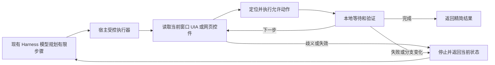

# Third Hand 对 HQHarness Windows 自动化提速的评估

调研日期：2026-10-20。目标是 Windows 上 Computer Use 与 Browser Use 的端到端体验；用户确认主要慢在每次点击前等待模型思考或截图。本次只做源码与官方资料调研，未修改客户端、未安装第三方、未进行 Windows 端到端性能实测。以下优化是实施建议，不是已交付能力。

## 结论

Third Hand 的执行方式值得借鉴，但不适合作为 Windows 插件直接内置。它是 macOS 14+ 的 Swift/AppKit 客户端，使用 macOS 的 arc-cua 驱动。对 HQHarness 更合适的路线是复用已经随安装包分发的 Cua Driver 和 Electron Chromium：**按窗口/网页读取精简控件，当前模型一次规划有限步骤，本地逐步执行和验证，异常时再回模型。**

重点不是单次鼠标点击发得更快，而是减少动作之间的模型请求、整屏截图、图片处理及无效等待。不能仅通过删除固定 150 ms 等待解决用户所述的思考停顿，也不能先承诺加速倍数。

来源：[Third Hand 说明](https://github.com/shhivv/third-hand/blob/412fbb8b546487fd2a5a3161efe900c2dcb5a187/README.md)、[macOS 平台声明](https://github.com/shhivv/third-hand/blob/412fbb8b546487fd2a5a3161efe900c2dcb5a187/Package.swift)、[Windows Cua 0.28 源码](https://github.com/trycua/cua/tree/1b50c02e2d34734f64d2d22f54eb76cc97b4a663/libs/cua-driver/rust/crates/platform-windows)。

## Third Hand 实际提供的启发

| 机制 | 对等待时间的意义 | 集成判断 |
| --- | --- | --- |
| 主模型输出一组有限步骤，本地依次执行，失败再规划 | 减少每次动作都重新请求主模型的机会 | 适合移植到现有 Harness 工具契约；不另建 Agent runtime |
| 用无障碍控件的名称、角色、值定位；必要时本地 OCR | 许多普通表单和按钮不需要上传整屏让模型找坐标 | Windows 用现有 SDK 的 UIA，浏览器沿用 CDP/AX |
| 精确匹配先执行，歧义时才询问决策模型 | 避免简单控件选择也经过一次完整大模型生成 | 可先用确定性匹配；不要默认新增一个云服务请求 |
| 每步观察、检查目标、等待结果 | 减少错点及重复尝试 | 仍须保留，不能为了提速盲目连续点击旧坐标 |

Third Hand 的默认规划依赖 ChatGPT，歧义选择使用 TypeSafe/Jev；这不等于本地离线模型。直接引入会增加账号、外部 API、网络和运行时依赖。建议保留 HQHarness 当前的模型入口与 AgentOS 额度机制。Third Hand 的 MIT 许可不等于第三方云服务的商业接入条款已经完成审查。[项目说明与许可](https://github.com/shhivv/third-hand/tree/412fbb8b546487fd2a5a3161efe900c2dcb5a187)

arc-cua 的 Chrome 后端支持 Windows 网页操作，不能由此推导它有 Windows 桌面驱动。它的 Chrome 观察毫秒数和少量浏览器任务演示，也不能替代 HQHarness 在 Windows 上的完整任务测量。[固定依赖版本说明](https://github.com/shhivv/arc-cua/blob/4f313bdf35c8b4043f5287f833b90dea9062dbfe/README.md)

## HQHarness 当前已经确认的事实

### Computer Use

- `src/main/automation/native-input.ts:89` 只调用 `get_desktop_state`，输入固定主屏 desktop/foreground。
- `src/main/automation/computer.ts:35` 每次观察都要原生截图，再进行 PNG/base64 解码、缩放和重新编码；插件还要保存图片附件。
- `computer.ts:58` 起的快照只允许一次输入；输入后没有返回新观察，模型接着要取得下一张观察才能继续输入。
- 每次成功输入后有固定 150 ms 等待。十次输入仅这一项累计 1.5 秒，不包括模型或截图；它不能单独解释较长的思考等待。
- 驱动实例已经缓存。每次 `startSession` 是附着/恢复，不是每次重建驱动；不能以删除会话恢复作为提速方案。
- 锁定的 Cua Driver 0.28.0 已有 Windows UIA、窗口观察、element token、语义点击和控件写值，当前宿主封装没有接出。`get_desktop_state.text` 仅有截图尺寸摘要，简单透传它得不到控件树。

源码：[本地 Computer 实现](../src/main/automation/computer.ts)、[本地原生适配](../src/main/automation/native-input.ts)、[附件桥接](../packages/hqharness-automation/index.js)、[Windows get_window_state](https://github.com/trycua/cua/blob/1b50c02e2d34734f64d2d22f54eb76cc97b4a663/libs/cua-driver/rust/crates/platform-windows/src/tools/impl_.rs#L1189)、[UIA 控件动作](https://github.com/trycua/cua/blob/1b50c02e2d34734f64d2d22f54eb76cc97b4a663/libs/cua-driver/rust/crates/platform-windows/src/uia/mod.rs#L847)。

### Browser Use

- `src/main/automation/browser.ts:54` 已用 CDP 的 AX tree 和元素 ref，不必再装另一套浏览器驱动。
- 当前动作执行后已经返回新 observation，不能把“动作＋观察合并”当作尚未具备的 Browser 能力。
- 截图默认打开；现有 `screenshot:false` 已能只返回结构化页面内容。可把无需视觉的路径改为结构化输出优先，保留按需截图。
- 仍是单动作契约。明确的“定位输入框→输入指定文本→点击搜索→等待结果”可以设计为本地受限步骤，减少主模型的逐步调度。

源码：[浏览器观察](../src/main/automation/browser.ts)、[工具契约](../packages/hqharness-automation/index.js)、[输入校验](../src/shared/automation.ts)。

### 目前无法确认的耗时

没有用户 Windows 版本的分段 trace，无法给模型、截图、网络、排队和原生输入分配百分比。两个工具调用也不必然等于两次模型请求，因为 Harness 一次响应可携带多个工具调用。

还需核对实际部署的图片能力、请求上下文量和推理参数。本地 managed profile 的 `reasoning:false` 不能证明用户当前每个会话都使用该 profile；图片能力来自 lease metadata，不能根据 DeepSeek 型号名称推断。text-only 模型的上游适配会把图片变为占位文本，这条路径不能当作有效视觉识别来验收。[当前模型 profile](../packages/hqharness-model-access/profile.js)、[模型能力要求](hqharness-model-access.md)

## 建议的生产实现

### 执行位置和职责

保持现有 Harness runtime 和 Web UI。模型规划仍在 Harness；内置工具把有限、声明式步骤交给 Electron main 的受控执行器。Cua 负责桌面窗口/控件，Electron debugger 负责独立浏览器页面。执行器不引入独立模型会话、另一套 Agent，也不允许模型提交任意脚本。

### 两种能力分别改什么

| 能力 | 应实现的变化 | 对慢的直接作用 |
| --- | --- | --- |
| Computer Use | 发现并锁定目标 PID/窗口；有界 `get_window_state`；返回控件与允许动作；按 token 操作；动作后直接观察/验证 | 普通应用减少全屏截图、找坐标和显式 observe 往返 |
| Browser Use | 沿用 CDP/AX；普通路径减少截图；只返回相关控件/变更摘要；把明确步骤交给本地连续执行 | 少传图片、少重复页面文本、少逐步模型请求 |
| 两者共同 | 有界步骤列表、明确成功条件、异常返回、分阶段计时 | 主模型用于规划和处理异常，本地负责执行已确定的步骤 |

步骤应包含动作、可唯一匹配的目标、调用方给定的文字、前置条件和可执行的后置断言。建议初始契约将每个子任务限制在最多 8 步、15 秒，并与现有输入大小限制一并校验；这是拟定的产品限制，尚未实施或验证。导航/弹窗变化后重新观察并解析目标，不能把初始 ref 或旧坐标套用于后续所有页面。

例如输入并搜索，可由模型一次给出“定位名为搜索的文本框、填入指定词、点击搜索按钮、等待结果区域出现”。本地每步都检查窗口、控件有效性及结果，正常完成时返回一次汇总；歧义或预期不成立就停在失败位置并提供最新状态。不能将未经验证的历史坐标串起来执行。

输入操作默认不因超时自动重放；调用方必须知道哪些步骤已完成、哪一步可能已产生副作用。保留当前 owner 隔离、授权、停止、取消和超时；涉及发送、付款等操作沿用明确授权边界。后台操作仅用于已验证的应用/动作组合。

### 需要避免的实现误区

- 不能一次读取完整 Windows 桌面的巨大 UIA 树。锁定窗口并设置节点/深度上限，保留截断和 degraded 状态。0.28 默认为 5000 节点、深度 25；query 主要投影结果，不保证省去底层遍历。
- 不承诺所有窗口都能后台操作；UIA Invoke 可用，不代表该应用的快捷键或拖动也能后台。
- canvas、自绘控件和部分 Office 区域仍需截图回退；图片模型能力不足时应明确失败或切换已验证路径，不能让模型猜坐标。
- SDK 已有有界 `verifyState`，但未确认公开通用 UIA 事件订阅或任意 batch；本地步骤执行器需由宿主实现，不能假定已有这些接口。
- Browser 的 DOM-only 路径不等于对任意页面注入模型生成的 JavaScript；仍只使用固定受控 CDP 操作。

这些边界见 [Windows 语义自动化详细核查](windows-semantic-automation-research.zh.md) 和 [Microsoft UIA 控件模式](https://learn.microsoft.com/en-us/windows/win32/winauto/uiauto-controlpatternsoverview)。

## 以完整任务验收速度

先在同一台 Windows、同一模型端点、同一网络和相同初始状态记录旧版与新版，并增加同任务的人工操作时间作为体验对照。初次授权/冷启动单列，避免用已授权热启动对比旧版冷启动。

记录任务总时间及每一步的授权/排队、原生观察、图片处理/附件保存、模型等待与生成、原生输入和结果等待；另记模型请求数、截图数、图片字节、重试次数和成功率。分段计时使用各进程单调时钟，关联请求 ID，不记录输入正文、控件私密内容或凭据。

固定样例覆盖：网页查询和表单、记事本文字编辑、文件选择、Word/Excel 常用动作、钉钉网页和自绘界面回退；同时覆盖 Windows 10/11、常用 DPI、多屏和锁屏/RDP 恢复。数据使用隔离测试文件，不改用户真实文档。

建议最低性能门槛（不是已取得结果）：普通控件任务截图数量降低至少 50%，同组任务端到端中位时间降低至少 30%，P95 不恶化，成功率不低于基线。这些相对指标还须结合人工对照判断课堂体验；仅比旧版快，不代表已经优于手工操作。若仍然主要耗在模型规划，就继续减少上下文和重复规划，而不能凭本地点击毫秒数宣布完成。

## 证据和本次交付状态

- 第三方固定版本与源码分析：[Third Hand 源码调研](third-hand-source-research.zh.md)。
- 现有驱动的 Windows 支持：[Windows 结构化自动化调研](windows-semantic-automation-research.zh.md)。
- HQHarness 当前实现核对的是本机 0.1.5 / 自动化插件 0.1.2 源码；不是对用户机器运行状态的读取。
- 本次只新增调研文档，未重打安装包，也未宣称性能已经改善。
